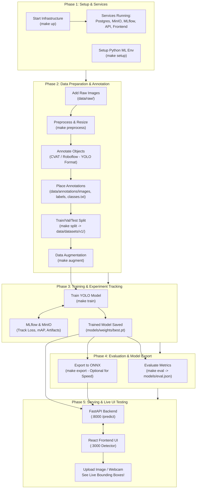

# CV Platform: base project

> **Production-grade MLOps platform to train YOLO models, track with MLflow, and serve with FastAPI & React.**

Annotate → train YOLO → track in MLflow → serve with FastAPI → use from React.

## Flow Diagram



## Services (docker compose)

| Service | URL |
|---|---|
| Frontend (React) | http://localhost:3000 |
| API docs (FastAPI) | http://localhost:8000/docs |
| MLflow | http://localhost:5000 |
| MinIO console | http://localhost:9001 (login from `.env`) |
| PostgreSQL | localhost:5432 |

CVAT is run separately from its own official compose setup so upgrades don't touch this project.

## Quick start

```bash
git init && dvc init                  # once
make up                               # postgres, minio, mlflow, api, frontend
make setup                            # python env for ml/ (install CUDA PyTorch first)
source .venv/bin/activate
```

## Workflow

1. Put images in `data/raw/` then `make preprocess` → `data/processed/`
2. Annotate `data/processed/` in CVAT and export in **YOLO** format
3. Copy the export so you have:
   ```
   data/annotations/images/*.jpg
   data/annotations/labels/*.txt
   data/annotations/classes.txt      # one class name per line, in class-id order
   ```
4. `make split` → `data/datasets/v1/` (train/val/test + `data.yaml`)
5. `make augment` → adds augmented copies to the **train** split only
6. `dvc add data/datasets/v1` → version the dataset, commit the `.dvc` file
7. `make train` → logs to MLflow, saves `models/weights/best.pt`
8. `make eval` → test-split mAP and per-class mAP in `models/eval.json`
9. `docker compose restart api` → the UI at :3000 now runs your model

Optional: `make export` writes ONNX to `models/exported/`
(set `MODEL_PATH=/models/exported/best.onnx` in `.env` to serve it).

## Notes

- Train from the repo root; paths in the configs are relative to it.
- No GPU? Set `device: cpu` in `ml/configs/train.yaml`.
- Ultralytics YOLO is AGPL-3.0: fine for learning and portfolios, check the license before commercial use.
- Next steps: SAM 2 auto-annotation script, DVC remote on MinIO, a model registry in MLflow, auth on the API.
