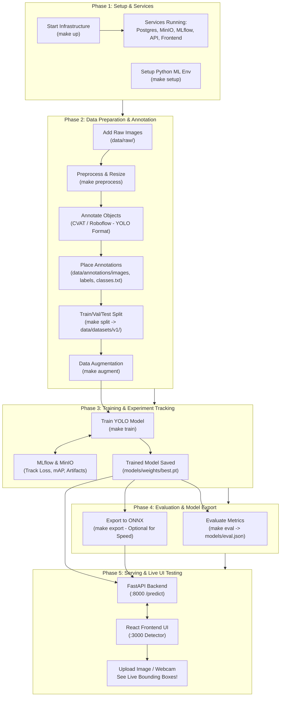

# YOLO MLOps Platform

> **Production-grade MLOps platform to train YOLO models, track with MLflow, and serve with FastAPI & React.**

Annotate → Train YOLO → Track in MLflow → Serve with FastAPI → Test live in React UI.

---

## 🔄 End-to-End Workflow Diagram



---

## 🚀 Services (Docker Compose)

| Service | URL | Notes |
|---|---|---|
| **Frontend (React)** | [http://localhost:3000](http://localhost:3000) | Live bounding box visualization UI |
| **API docs (FastAPI)** | [http://localhost:8000/docs](http://localhost:8000/docs) | Swagger UI for inference endpoint |
| **MLflow** | [http://localhost:5000](http://localhost:5000) | Experiment tracking & metric logs |
| **MinIO Console** | [http://localhost:9001](http://localhost:9001) | S3-compatible artifact storage |
| **PostgreSQL** | `localhost:5432` | MLflow metadata store |

---

## ⚡ Quick Start

```bash
git init && dvc init                  # Initialize repository & DVC
make up                               # Start Postgres, MinIO, MLflow, API, Frontend
make setup                            # Create Python virtual environment for ml/
source .venv/bin/activate
```

---

## 🛠️ Step-by-Step Workflow

1. **Ingest Raw Data:**
   Put images in `data/raw/` then run:
   ```bash
   make preprocess
   ```
   *(Resizes and cleans images into `data/processed/`)*

2. **Annotate:**
   Annotate images in CVAT / Roboflow and export in **YOLO** format:
   ```text
   data/annotations/images/*.jpg
   data/annotations/labels/*.txt
   data/annotations/classes.txt      # One class name per line, in class-id order
   ```

3. **Split Dataset:**
   ```bash
   make split
   ```
   *(Creates train/val/test splits + `data.yaml` inside `data/datasets/v1/`)*

4. **Augment (Optional):**
   ```bash
   make augment
   ```
   *(Applies Albumentations to the **train** split only)*

5. **Version Dataset:**
   ```bash
   dvc add data/datasets/v1
   ```

6. **Train Model:**
   ```bash
   make train
   ```
   *(Trains YOLO model, logs metrics/artifacts to MLflow, saves best weights to `models/weights/best.pt`)*

7. **Evaluate:**
   ```bash
   make eval
   ```
   *(Computes test-split mAP and per-class metrics in `models/eval.json`)*

8. **Deploy to UI:**
   ```bash
   docker compose restart api
   ```
   *(The React UI at `http://localhost:3000` is now serving your new model)*

9. **Export (Optional):**
   ```bash
   make export
   ```
   *(Exports to ONNX in `models/exported/`. Set `MODEL_PATH=/models/exported/best.onnx` in `.env` to serve ONNX)*

---

## 📌 Notes & Best Practices

- Train from the repo root; paths in configs are relative to it.
- No GPU? Set `device: cpu` in `ml/configs/train.yaml`.
- Ultralytics YOLO is AGPL-3.0: fine for learning and portfolios, check the license before commercial use.
