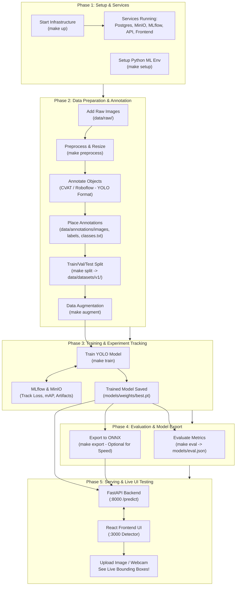
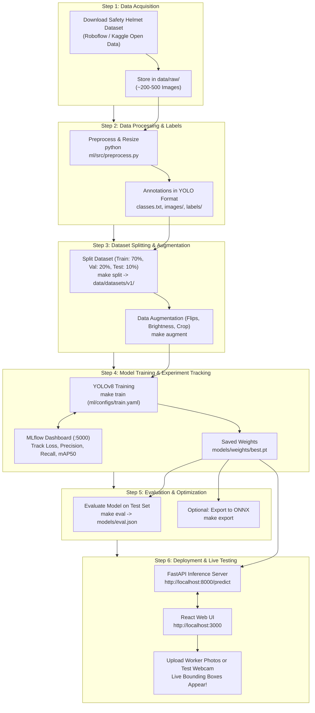

# CV Platform: base project

> **Production-grade MLOps platform to train YOLO models, track with MLflow, and serve with FastAPI & React.**

Annotate → train YOLO → track in MLflow → serve with FastAPI → use from React.

## Flow Diagram



## Project Implementation Flow: Workplace Safety & Helmet Detection



## Project Structure

End-to-end repository structure with the single-line purpose of each file and folder:

```text
cv-platform/
├── .env.example                 # Template for environment variables (DB URLs, paths, secrets)
├── docker-compose.yml           # Multi-service container orchestration (Postgres, MinIO, MLflow, API, UI)
├── Makefile                     # Automation shortcuts (make setup, split, train, eval, up)
├── README.md                    # Project documentation, architecture diagrams, and usage guide
├── yolo11n.pt                   # Pretrained base YOLO11 nano model checkpoint
│
├── backend/                     # FastAPI backend inference service
│   ├── Dockerfile               # Container build recipe for production API deployment
│   ├── requirements.txt         # Backend Python dependencies (FastAPI, Uvicorn, SQLAlchemy)
│   └── app/
│       ├── db.py                # Database engine setup and SQLAlchemy session manager
│       ├── main.py              # REST API application and endpoints (/predict, /health, /predictions)
│       ├── models.py            # Database schema for logging prediction results and audit records
│       └── services/
│           └── inference.py     # Lazy model loader and YOLO prediction wrapper service
│
├── data/                        # Computer Vision dataset lifecycle management
│   ├── raw/                     # Original raw uncurated construction site images
│   ├── processed/               # Standardized and resized images prepared for annotation
│   ├── annotations/             # CVAT / Roboflow labels (classes.txt, images/, labels/)
│   └── datasets/
│       └── v1/                  # Versioned train/val/test splits with YOLO data.yaml
│
├── frontend/                    # Modern React user interface
│   ├── package.json             # Frontend dependencies and Vite scripts
│   ├── vite.config.js           # Vite dev server configuration with /api backend proxy
│   └── src/
│       ├── App.jsx              # Main UI with Image, Video Viewport & Live Webcam detection
│       ├── main.jsx             # React DOM bootstrap entry point
│       └── styles.css           # Clean responsive layout and video bounding-box overlay styling
│
├── infra/                       # Cloud & local infrastructure configuration
│   ├── mlflow/Dockerfile        # Container setup for MLflow experiment tracking server
│   └── postgres/init.sql        # Database initialization script for PostgreSQL metadata
│
├── ml/                          # Machine Learning & MLOps training pipelines
│   ├── requirements.txt         # ML Python dependencies (PyTorch CUDA, Ultralytics, Albumentations)
│   ├── configs/
│   │   ├── train.yaml           # Model training hyperparameters (epochs, batch size, learning rate)
│   │   └── augment.yaml         # Offline data augmentation rules (flips, brightness, crops)
│   └── src/
│       ├── download_dataset.py  # Automated script to download and curate PPE safety dataset
│       ├── preprocess.py        # Image standardization and pre-annotation image cleaner
│       ├── split_dataset.py     # Splits data into train/val/test and generates data.yaml
│       ├── augment.py           # Augmentation generator to balance and enrich training split
│       ├── train.py             # YOLO fine-tuning pipeline integrated with MLflow logging
│       ├── evaluate.py          # Calculates test mAP50, precision, recall, and per-class metrics
│       └── export.py            # Converts trained PyTorch model to optimized ONNX runtime format
│
├── mlruns/                      # Local MLflow experiment tracking logs and run metrics
└── models/                      # Model artifact storage and performance metrics
    ├── eval.json                # Test evaluation results (mAP50: 85.2%, latency, per-class stats)
    └── weights/
        └── best.pt              # Best fine-tuned YOLO11 checkpoint used for live inference
```

## Services (docker compose)

| Service | URL |
|---|---|
| Frontend (React) | http://localhost:3000 |
| API docs (FastAPI) | http://localhost:8000/docs |
| MLflow | http://localhost:5000 |
| MinIO console | http://localhost:9001 (login from `.env`) |
| PostgreSQL | localhost:5432 |

CVAT is run separately from its own official compose setup so upgrades don't touch this project.

## Quick start

```bash
git init && dvc init                  # once
make up                               # postgres, minio, mlflow, api, frontend
make setup                            # python env for ml/ (install CUDA PyTorch first)
source .venv/bin/activate
```

## Workflow

1. Put images in `data/raw/` then `make preprocess` → `data/processed/`
2. Annotate `data/processed/` in CVAT and export in **YOLO** format
3. Copy the export so you have:
   ```
   data/annotations/images/*.jpg
   data/annotations/labels/*.txt
   data/annotations/classes.txt      # one class name per line, in class-id order
   ```
4. `make split` → `data/datasets/v1/` (train/val/test + `data.yaml`)
5. `make augment` → adds augmented copies to the **train** split only
6. `dvc add data/datasets/v1` → version the dataset, commit the `.dvc` file
7. `make train` → logs to MLflow, saves `models/weights/best.pt`
8. `make eval` → test-split mAP and per-class mAP in `models/eval.json`
9. `docker compose restart api` → the UI at :3000 now runs your model

Optional: `make export` writes ONNX to `models/exported/`
(set `MODEL_PATH=/models/exported/best.onnx` in `.env` to serve it).

## Notes

- Train from the repo root; paths in the configs are relative to it.
- No GPU? Set `device: cpu` in `ml/configs/train.yaml`.
- Ultralytics YOLO is AGPL-3.0: fine for learning and portfolios, check the license before commercial use.
- Next steps: SAM 2 auto-annotation script, DVC remote on MinIO, a model registry in MLflow, auth on the API.
